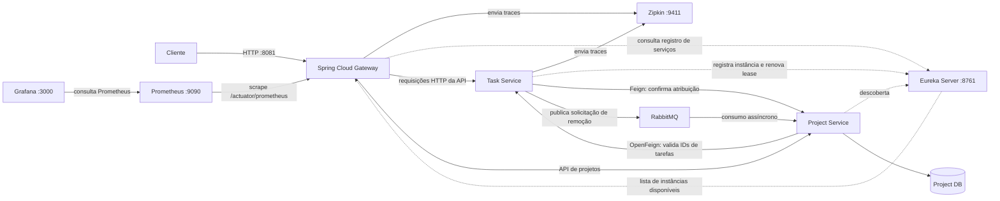
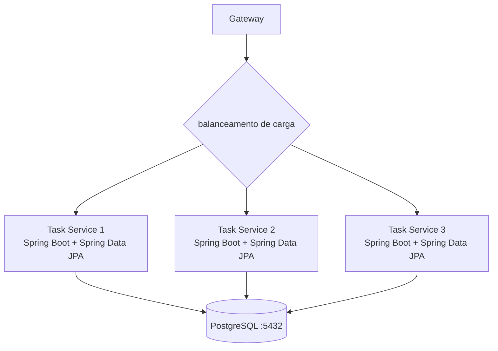

# TaskFlow — laboratório de microsserviços

Projeto de estudo sobre microsserviços com **Java 21**, **Spring Boot**, **Spring Cloud Gateway**, **Eureka**, **Spring Data JPA**, **PostgreSQL**, **RabbitMQ** e **Docker Compose**. O Gateway recebe as chamadas dos clientes, descobre os serviços pelo Eureka e distribui as requisições entre três instâncias do serviço de tarefas.

## Arquitetura



### Detalhe do Task Service



As três instâncias compartilham o banco `task-db`. O PostgreSQL persiste os dados no volume Docker `task_db_data` e não publica sua porta no host.

| Componente | Função | Acesso local |
|---|---|---|
| `gateway` | Roteamento, balanceamento, retry, timeout e circuit breaker | `http://localhost:8081` |
| `eureka-server` | Registro e descoberta de serviços | `http://localhost:8761` |
| `rabbitmq` | Mensageria de remoção de vínculos e DLQ | Painel `http://localhost:15672`; AMQP `localhost:5672` |
| `task-service-1` | Primeira instância da API de tarefas | Rede interna Docker, porta `8080` |
| `task-service-2` | Segunda instância da API de tarefas | Rede interna Docker, porta `8080` |
| `task-service-3` | Terceira instância da API de tarefas | Rede interna Docker, porta `8080` |
| `task-db` | Banco PostgreSQL compartilhado pelas instâncias do Task Service | Rede interna Docker, porta `5432` |
| `prometheus` | Coleta métricas do Gateway | `http://localhost:9090` |
| `grafana` | Dashboards para visualizar métricas do Prometheus | `http://localhost:3000` |
| `zipkin` | Coleta e visualização de traces distribuídos | `http://localhost:9411` |

As setas pontilhadas mostram o plano de descoberta: as instâncias registram e renovam seus leases no Eureka, e o Gateway obtém dele a lista de instâncias disponíveis. O Eureka não recebe nem encaminha as chamadas de negócio. As setas contínuas mostram o tráfego da API: o Gateway escolhe uma instância e encaminha a requisição HTTP diretamente a ela.

As instâncias Task Service não publicam suas portas no host. O acesso externo às APIs é feito pelo Gateway. No Compose, o Gateway publica a porta `8081` do host e encaminha para a porta `8080` do container.

## Projetos e tarefas

Toda tarefa deve pertencer a exatamente um projeto. Crie primeiro o projeto
(`POST /api/v1/projects`); ele pode começar sem tarefas:

```json
{
  "name": "Estudo de microsserviços",
  "description": "Implementar os serviços do TaskFlow"
}
```

Use o ID retornado como `projectId` ao criar ou atualizar uma tarefa:

```json
{
  "title": "Estudar Flyway",
  "description": "Praticar migrações versionadas no PostgreSQL.",
  "projectId": 1
}
```

`projectId` é obrigatório e positivo. O `task-service` registra o vínculo via
Spring Cloud OpenFeign antes de confirmar a criação local. Projeto inexistente
retorna `422`; falha de comunicação retorna `503` e reverte a criação da tarefa.
A atualização exige o projeto atual; tentar atribuir a tarefa a outro projeto
retorna `409`. A resposta da tarefa mantém `id`, `title` e `description`;
os vínculos são consultados em `taskIds` na resposta do projeto.

O `project-service` possui banco PostgreSQL próprio (`project-db`), registra-se
no Eureka e expõe pelo Gateway:

- `POST /api/v1/projects`: cria um projeto, com `taskIds` opcional.
- `GET /api/v1/projects`: lista com paginação (`page`, `size`, `sort`).
- `GET /api/v1/projects/{id}`: consulta um projeto e seus `taskIds`.
- `PUT /api/v1/projects/{id}`: atualiza nome e descrição; omitir `taskIds` preserva os vínculos.
- `DELETE /api/v1/projects/{id}`: exclui apenas projetos sem tarefas (`409` se houver vínculos).

`name` é obrigatório, com até 100 caracteres; `description` é opcional.
Quando informado, `taskIds` aceita uma lista vazia ou IDs positivos, sem
repetições. A API de projetos mantém a validação de existência e exclusividade
dos IDs, mas não permite remover vínculos pela atualização do projeto.

Para remover uma tarefa, use `DELETE /api/v1/tasks/{id}`. A exclusão e a entrada
na outbox `pending_task_unlinks` são confirmadas na mesma transação local.
A cada 5 segundos, `TaskLinkCleanup` publica as pendências no RabbitMQ e só as
remove do banco após confirmação positiva do broker, sem retorno por falta de
rota. O `project-service` consome a mensagem e remove o vínculo em uma transação.
Até o consumo, a exclusão do projeto continua retornando `409`. Criações revertidas
também enfileiram a limpeza de possíveis vínculos remotos.

Os vínculos continuam em `project_tasks`, com exclusividade garantida pelo banco.
Não há chave estrangeira entre os bancos nem transação distribuída. O vínculo
é confirmado antes da tarefa ficar visível; sua remoção ocorre depois da exclusão
local. Os endpoints de coordenação em `/internal/project-task-links` ficam na
rede interna e não possuem rota no Gateway. Não devem ser publicados externamente.
Uma interrupção do processo entre a chamada remota e a compensação pode deixar
um vínculo sem tarefa; nesse caso é necessária uma limpeza administrativa do
vínculo, após confirmar que a tarefa não existe.

A importação automática de tarefas órfãs foi removida. A inicialização não
percorre tarefas nem aguarda uma etapa de importação. O antigo projeto de
importação permanece como projeto comum, preservando os dados já existentes.
A migração histórica `V2` é mantida para compatibilidade com o Flyway; a `V3`
remove a marca de sistema usada exclusivamente pela importação.

Os dois serviços usam OpenFeign, Eureka e Spring Cloud LoadBalancer. Os limites
de conexão (1000 ms) e leitura (2000 ms) ficam em
`spring.cloud.openfeign.client.config.<nome-do-serviço>` nos respectivos
`application.properties`. O módulo `feign-micrometer` instrumenta as chamadas.

Copie `project-service/.env.example` para `project-service/.env` e ajuste as
credenciais locais antes de executar o Compose.

## Requisitos

- Docker com Docker Compose plugin
- Portas `8081`, `8761`, `9090`, `3000`, `9411`, `5672` e `15672` livres no host

## Executar

Na raiz do repositório:

```bash
docker compose up --build -d
```

Acompanhar os logs:

```bash
docker compose logs -f gateway eureka-server task-service-1 task-service-2 task-service-3 task-db prometheus grafana zipkin
```

Verificar os containers:

```bash
docker compose ps
```

Encerrar o ambiente:

```bash
docker compose down
```

Para definir a versão informativa das aplicações, passe `APP_VERSION` ao Compose:

```bash
APP_VERSION=1.2.0 docker compose up --build -d
```

O valor padrão é `1.0.0`.

As credenciais do PostgreSQL ficam em `task-service/.env`. Ajuste `POSTGRES_DB`, `POSTGRES_USER` e `POSTGRES_PASSWORD` nesse arquivo antes de subir o ambiente. O modelo versionado está em `task-service/.env.example`; o arquivo com as credenciais locais é ignorado pelo Git.

## Endpoints

As tarefas aceitam `title` e uma descrição opcional em `description`. A descrição é
armazenada como texto e retornada na criação, consulta, listagem e atualização.
Tarefas antigas continuam válidas, com `description` igual a `null`. No `PUT`,
omitir a descrição ou enviar `null` limpa esse campo.

Exemplo de corpo para criar ou atualizar uma tarefa:

```json
{
  "title": "Estudar Flyway",
  "description": "Praticar migrações versionadas no PostgreSQL.",
  "projectId": 1
}
```

### Listar tarefas

```bash
curl http://localhost:8081/api/v1/tasks
```

O endpoint aceita `page` (começando em `0`), `size` e `sort`. Por exemplo, para
listar a segunda página com 10 tarefas, ordenadas pelo título em ordem crescente:

```bash
curl 'http://localhost:8081/api/v1/tasks?page=1&size=10&sort=title,asc'
```

Exemplo de resposta:

```json
{
  "service": "task-service",
  "instance": "instancia 2",
  "tasks": [
    { "id": 1, "title": "Estudar microsserviços" },
    { "id": 2, "title": "Aprender API Gateway" }
  ],
  "pagination": {
    "page": 0,
    "size": 20,
    "totalElements": 2,
    "totalPages": 1
  }
}
```

O número em `instance` identifica qual das três instâncias respondeu. O balanceador escolhe uma instância registrada no Eureka; a sequência pode variar.

O banco começa sem tarefas cadastradas; a lista acima mostra tarefas depois de criadas. A API também permite criar, buscar, atualizar e excluir tarefas pelo Gateway:

```bash
# Criar (use o ID de um projeto existente)
curl -X POST http://localhost:8081/api/v1/tasks \
  -H 'Content-Type: application/json' \
  -d '{"title":"Preparar release","projectId":1}'

# Buscar por ID
curl http://localhost:8081/api/v1/tasks/1

# Atualizar o título
curl -X PUT http://localhost:8081/api/v1/tasks/1 \
  -H 'Content-Type: application/json' \
  -d '{"title":"Publicar release","projectId":1}'

# Excluir
curl -X DELETE http://localhost:8081/api/v1/tasks/1
```

### Health checks do serviço de tarefas

O Gateway encaminha os caminhos abaixo para os endpoints Actuator do Task Service:

```bash
curl http://localhost:8081/api/v1/health
curl http://localhost:8081/api/v1/health/liveness
curl http://localhost:8081/api/v1/health/readiness
```

Os endpoints diretos do Actuator existem dentro de cada instância, mas as instâncias não são publicadas diretamente no host.

### Métricas e Prometheus

O Gateway e o Task Service expõem os endpoints Actuator de métricas. O Prometheus configurado em `prometheus/prometheus.yaml` coleta o Gateway e as três réplicas do Task Service pela rede interna do Compose, em `/actuator/prometheus`.

- Interface do Prometheus: `http://localhost:9090`
- Métricas do Gateway em formato Prometheus: `http://localhost:8081/actuator/prometheus`
- Catálogo de métricas do Gateway: `http://localhost:8081/actuator/metrics`

Exemplo para consultar o endpoint Prometheus do Gateway:

```bash
curl http://localhost:8081/actuator/prometheus
```

As três réplicas do Task Service aparecem no Prometheus no job `task-service`; a label `instance` distingue cada container.

### Grafana

Abra `http://localhost:3000` e entre com o usuário e a senha padrão `admin`. O Grafana solicitará a troca da senha no primeiro acesso. A fonte Prometheus e o dashboard **TaskFlow - Gateway e Task Service** são provisionados automaticamente; o dashboard mostra memória heap, CPU, taxa de requisições e latência p95 do Gateway e das instâncias do Task Service. Os dados locais do Grafana são mantidos no volume `grafana_data`.

### Tracing distribuído

O Gateway e o Task Service propagam contexto W3C entre chamadas e exportam spans para o Zipkin. Para consultar os traces, abra `http://localhost:9411` e execute uma busca. O ambiente amostra 100% das requisições para facilitar o acompanhamento durante o desenvolvimento.

### Eureka

Abra `http://localhost:8761` para visualizar o painel do Eureka. O endpoint de registro também pode ser consultado com:

```bash
curl http://localhost:8761/eureka/apps
```

## Resiliência no Gateway

O Gateway está configurado com:

- **Timeout de conexão:** 1 segundo.
- **Timeout de resposta:** 3 segundos por tentativa, aplicado pelo cliente HTTP; o TimeLimiter adicional do circuit breaker fica desativado para não antecipar esse limite.
- **Retry:** até duas tentativas adicionais para requisições `GET` em falhas de upstream e timeouts configurados.
- **Circuit breaker:** circuitos separados para as APIs de tarefas e projetos; a configuração abre o circuito após pelo menos 5 chamadas na janela de 10, quando pelo menos 50% falham. O circuito permanece aberto por 10 segundos antes de permitir chamadas de recuperação.
- **Fallback:** quando o serviço não pode responder, o Gateway devolve HTTP `503` com um corpo JSON indicando indisponibilidade (`task-service-unavailable` ou `project-service-unavailable`).
- **Health checks:** não usam circuit breaker nem fallback, para consultar o estado atual do serviço em cada requisição. Mantêm os limites de tempo e o retry de `GET`.

As chamadas Feign também possuem circuitos no serviço que inicia cada chamada:
`taskLookup` no `project-service` e `projectTaskAssignment` no `task-service`.
A remoção de vínculos é assíncrona via RabbitMQ e não usa Feign nem circuit breaker.
Esses circuitos usam janela de 10 chamadas, mínimo de 5, limiar de falha de 50%,
espera de 10 segundos e duas chamadas de recuperação. Falhas HTTP 5xx e de
transporte contam como falhas; HTTP 4xx (incluindo `404` e `409`) são ignorados
na contagem. Circuito aberto retorna `503`, sem confirmar vínculos fictícios.
A outbox mantém mensagens pendentes enquanto o broker não confirma a publicação. Os timeouts
Feign de conexão (1 segundo) e leitura (2 segundos) continuam limitando cada chamada.
Não há circuit breaker nos controllers nem nas operações locais dos bancos.

Exemplo de fallback para tarefas:

```json
{
  "service": "api-gateway",
  "error": "task-service-unavailable"
}
```

## Mensageria com RabbitMQ

A atribuição de uma tarefa ao projeto continua síncrona via Feign. A remoção do
vínculo usa uma mensagem JSON versionada, conforme
[`task-unlink-requested.v1.schema.json`](docs/messaging/task-unlink-requested.v1.schema.json):

```json
{"taskId": 42}
```

- Exchange durável: `taskflow.events` (direct).
- Routing key: `task.unlink-requested.v1`.
- Fila quorum durável: `taskflow.project.task-unlink.v1`.
- Dead-letter exchange: `taskflow.events.dlx`.
- Fila de rejeitados: `taskflow.project.task-unlink.v1.dlq`.

O cabeçalho `__TypeId__` usa o identificador `task-unlink-requested.v1`, sem expor
o pacote Java do produtor como contrato. Ambos os serviços declaram a mesma
topologia; as mensagens são persistentes. O publicador aguarda confirmação por
até 5 segundos. Falha de conexão, timeout, NACK ou mensagem retornada preserva a
outbox para uma próxima tentativa. A publicação pode ocorrer mais de uma vez,
inclusive entre as três instâncias; o consumidor é idempotente.

O consumidor confirma a mensagem somente após o retorno do serviço transacional.
Falhas recebem até 3 tentativas, com intervalos de 1 e 2 segundos; depois seguem
para a DLQ, sem reenvio infinito. Mensagens inválidas também são rejeitadas.
A DLQ exige inspeção e reenvio administrativo após corrigir a causa; não é
reprocessada automaticamente. Uma mensagem confirmada pelo broker já não fica
na outbox, mesmo que o consumo ainda esteja pendente ou tenha terminado na DLQ.

O RabbitMQ persiste seus dados no volume `rabbitmq_data`. O painel fica em
`http://localhost:15672`, com usuário local `taskflow` e senha de desenvolvimento
`taskflow-local`. Para personalizar as credenciais antes da primeira inicialização,
defina `RABBITMQ_USER` e `RABBITMQ_PASSWORD` no ambiente do Compose. As portas AMQP
e do painel são publicadas somente em `127.0.0.1`.

Os serviços usam `RABBITMQ_HOST`, `RABBITMQ_PORT`, `RABBITMQ_USER` e
`RABBITMQ_PASSWORD`; no Docker, o host é `rabbitmq`. Os nomes podem ser ajustados
pelas propriedades `taskflow.messaging.exchange`,
`taskflow.messaging.task-unlink-queue` e `taskflow.messaging.task-unlink-routing-key`,
sempre com os mesmos valores nos dois serviços.

### Eventos de criação, atualização e exclusão

Ambos os serviços publicam eventos de ciclo de vida no exchange `taskflow.events`:

| Serviço | Routing keys | Fila durável padrão |
|---|---|---|
| Tarefas | `task.created.v1`, `task.updated.v1`, `task.deleted.v1` | `taskflow.task.lifecycle.v1` |
| Projetos | `project.created.v1`, `project.updated.v1`, `project.deleted.v1` | `taskflow.project.lifecycle.v1` |

Os contratos estão em
[`task-lifecycle-event.v1.schema.json`](docs/messaging/task-lifecycle-event.v1.schema.json)
e [`project-lifecycle-event.v1.schema.json`](docs/messaging/project-lifecycle-event.v1.schema.json).
Exemplo de evento de atualização:

```json
{
  "eventId": "a6f61cb9-b8c9-4a91-9a35-21f84a6e5e15",
  "eventType": "task.updated.v1",
  "schemaVersion": 1,
  "occurredAt": "2026-10-29T15:00:00Z",
  "data": {
    "taskId": 42,
    "title": "Tarefa atualizada",
    "description": "Novos detalhes"
  }
}
```

A migração `V4` cria `lifecycle_event_outbox` em cada banco. O evento e a alteração
da entidade são gravados na mesma transação; uma falha reverte ambos. A cópia dos
dados é serializada antes da exclusão e não depende de consultar uma entidade que
já foi removida. Tarefas incluem `taskId`, `title` e `description`; projetos incluem
`projectId`, `name`, `description` e `taskIds`. Os vínculos continuam pertencendo ao
serviço de projetos. Atribuir ou remover um vínculo também gera `project.updated.v1`;
repetir uma atribuição ou remoção já aplicada não gera outro evento de atualização.

A cada 5 segundos, cada serviço tenta publicar até 200 eventos pendentes. O JSON,
o `eventId` e o horário originais são preservados entre tentativas. A mensagem é
persistente, usa `messageId=eventId` e só sai da outbox após ACK do broker e ausência
de retorno por falta de rota. A espera por confirmação é de até 5 segundos.
Sem broker ou sem rota válida, a operação HTTP pode concluir e o evento permanece
na outbox para reenvio. Não é possível garantir entrega exatamente uma vez:
consumidores devem deduplicar pelo `eventId` e tratar mensagens fora de ordem,
pois as instâncias publicam concorrentemente.

As filas de ciclo de vida são buffers para os assinantes; ainda não há consumidor
de negócio automático para esses seis tipos. Novos serviços devem ligar suas
próprias filas às routing keys desejadas para receber uma cópia de cada evento.
Cada fila padrão também possui uma DLQ de mesmo nome com sufixo `.dlq`. Não há
reenvio automático da DLQ. O nome do buffer pode ser ajustado por serviço com
`taskflow.messaging.lifecycle-queue`.

`TaskUnlinkRequested` continua separado: ele coordena a remoção efetiva do vínculo,
inclusive em compensações de criação. `task.deleted.v1` informa uma exclusão que
foi confirmada; uma criação revertida não gera `task.created.v1` nem `task.deleted.v1`.
Os eventos de ciclo de vida passam a existir para novas operações; registros
antigos não são republicados retroativamente. O intervalo de publicação usa
`taskflow.lifecycle-events.publish-delay-milliseconds`; nos testes, o envio pode
ser desligado com `taskflow.lifecycle-events.publisher-enabled=false`, mantendo
a gravação transacional dos eventos.

## Testes

Os módulos Java têm testes Maven. Para executá-los, entre no diretório de cada módulo:

```bash
(cd gateway && mvn test)
(cd task-service && mvn test)
(cd project-service && mvn test)
(cd eureka-server && mvn test)
```

Os testes comuns não exigem um broker. Para executar também os testes com
RabbitMQ real, usando filas isoladas das filas da aplicação:

```bash
docker compose up -d rabbitmq
mvn -f task-service/pom.xml -Dtaskflow.rabbitmq.integration=true test
mvn -f project-service/pom.xml -Dtaskflow.rabbitmq.integration=true test
```

Esses testes validam publicação confirmada, retorno por falta de rota, consumo
idempotente e envio para DLQ, com bancos H2 próprios e broker em `localhost:5672`.
Também verificam os seis eventos de ciclo de vida, seus dados e o reenvio com
o mesmo ID após falhas de roteamento.

Os scripts do gateway em `tests/` executam testes HTTP de integração: rotas de
tarefas e projetos, reescrita de caminhos, retry, circuit breaker e timeout real.
Usam Maven quando disponível; caso contrário, executam Maven com Java 21 no
Docker. Os servidores de teste são locais e não precisam do Compose em execução.

```bash
sh tests/test_gateway_config.sh
```

Também há um teste isolado de timeout e verificações de configuração de outros
componentes:

```bash
sh tests/test_gateway_timeout.sh
sh tests/test_gateway_failover.sh
sh tests/test_eureka_discovery.sh
sh tests/test_prometheus_config.sh
```

## Estrutura do repositório

```text
.
├── docker-compose.yml
├── prometheus/        # configuração de scrape do Gateway
├── grafana/           # datasource e dashboard provisionados
├── eureka-server/     # servidor Eureka
├── gateway/           # Spring Cloud Gateway e Resilience4j
├── task-service/      # API Spring Boot replicada em três containers
├── project-service/   # API de projetos e vínculos com tarefas
└── tests/             # testes de integração e verificações de configuração
```
